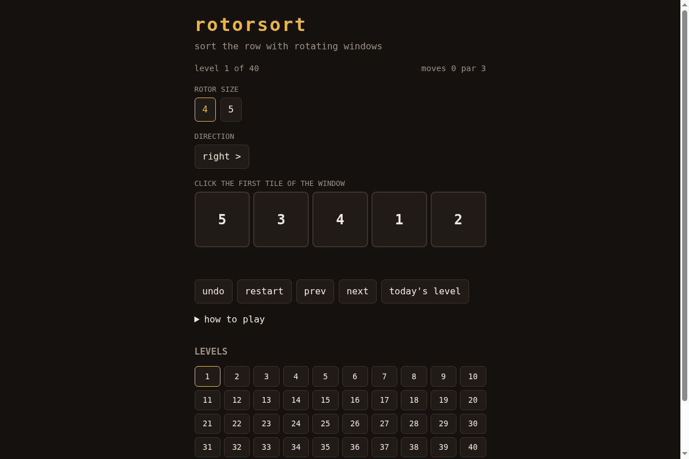

# rotorsort

Sort a row of numbers using rotating windows, in as few moves as possible.

**Play:** https://therealalexxx.github.io/rotorsort/


A level gives you a shuffled row and one or two rotor sizes. A rotor of size k
rotates any k neighbouring tiles one place, left or right. Par is the proven
minimum number of moves.

Open https://therealalexxx.github.io/rotorsort/#daily for the level of the day (same for everyone per UTC date). Solving it offers a copy-able result line.

Some rotor sizes cannot sort every row (3-rotors only make even permutations),
so the generator only keeps rows the solver can actually sort.

## How par is computed

`core.js` runs a breadth-first search over row states from the shuffled row, so
the first sorted state it reaches is at the fewest moves. Rows have at most 7
tiles, so the search is instant in the browser or in Node.

```
node gen.js <seed> <count>
```

## Tests

```
node --test
```

Covers the rotation maths, undo, unsolvable cases, an independent depth-first
check of optimality on sample rows, and that every shipped solution sorts its
row in exactly par moves.

## License

MIT
